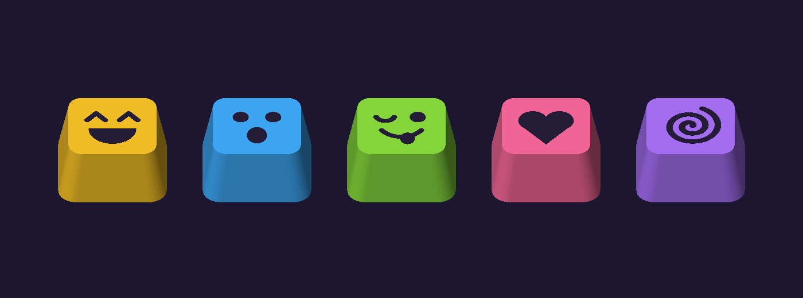

# MUMU keycaps

Five Cherry MX keycaps, one per key, each showing the animation that key plays on MUMU's screen
(by default): **1 laugh · 2 gasp · 3 silly · 4 love · 5 dizzy**, left to right along the smile arc.

## Files
- `stl/keycapN_<name>_body.stl` — the cap, icon recessed 0.8 mm into the top
- `stl/keycapN_<name>_icon.stl` — the icon inlay that fills the recess flush
- `mumu_keycaps_all.step` — all five, assembled
- `keycaps.py` — CadQuery source; every size is a parameter at the top

## Printing
- **Print top-down** (top face on the bed). The top is flat and the stem grows upward, so no supports.
- **Two colours (AMS):** select both STLs of a cap and load them together; answer *Yes* to
  "load as a single object with multiple parts". Give the icon part a dark filament.
  The colour change only happens in the first 0.8 mm, so it's quick.
- **One colour:** print just the `_body` file; the recessed icon still shows clearly.
- 0.4 mm nozzle, 0.12–0.16 mm layers, 3 walls, 20 % infill. PLA or PETG.
- Suggested colours (they match MUMU's LED flash for each key): yellow, sky blue, lime, pink, purple.

## Fit (v2)
- **Print `stl/fit_tester.stl` first** (2 minutes). It has five sockets numbered 1 (tight) to 5 (loose).
  Push a switch onto each and pick the one that grips firmly without forcing. The caps use **#3**
  (4.35 × 1.45 mm). If another one fits better, set `CROSS_L` / `CROSS_W` in `keycaps.py` to its size:

  | # | 1 | 2 | 3 | 4 | 5 |
  |---|---|---|---|---|---|
  | cross | 4.20 × 1.35 | 4.30 × 1.40 | 4.35 × 1.45 | 4.45 × 1.50 | 4.55 × 1.55 |

- The socket is recessed 2.4 mm up inside the cap (`STEM_GAP`), so the skirt drops down around the
  switch and the cap sits about 2 mm closer to the case than v1. Fully pressed, the skirt still stays
  ~3 mm above the case. Want it even lower? Raise `STEM_GAP` up to ~3.0.
- The inside is a 15.6 mm rounded square so the lowered skirt clears the switch housing.
- Caps are 18 × 18 mm at the base, 9 mm tall. If your keys sit closer than ~19.5 mm
  centre-to-centre in the case, reduce `BASE` / `TOP`.
